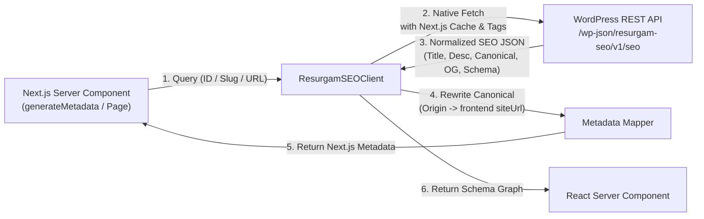

# Architecture: Headless WordPress SEO for Next.js

## Overview

The `@resurgam/seo-next` package serves as the bridge between the **Resurgam SEO WordPress plugin** and modern **Next.js App Router** frontend applications.

## Architectural Principles

### 1. WordPress as Single Source of Truth
WordPress content editors manage meta titles, descriptions, focus keywords, Open Graph images, redirects, and schema types in the WordPress admin panel. Next.js does not store or duplicate SEO editorial rules.

### 2. Frontend Origin Rewriting
WordPress stores internal permalinks (e.g. `https://cms.example.com/about-us/`). The Next.js package automatically rewrites these targets to the actual public storefront base URL (`https://www.example.com/about-us` or merchant custom domain).

### 3. Server-Side Execution (SSR / ISR)
Metadata and JSON-LD structured data are generated server-side during the initial HTML response. Search engine crawlers (Googlebot, Bingbot, etc.) receive 100% of the canonical tags, meta tags, and structured data in the initial stream without client-side hydration delays.

### 4. Zero Credential Exposure
WordPress administrative credentials, license keys, and AI gateway tokens remain securely on the backend server. The Next.js frontend only interacts with the public or key-authenticated REST endpoints.

### 5. Granular Cache Invalidation
The package tags fetch requests with predictable Next.js cache tags:
- `resurgam-seo`: Global tag for all SEO entities.
- `resurgam-post-${id}`: Tagged to specific post ID.
- `resurgam-slug-${slug}`: Tagged to specific slug.
- `resurgam-sitemap`: Tagged to the sitemap feed.

When an editor updates content in WordPress, the WordPress plugin fires revalidation webhooks (`/api/revalidate`) targeting these tags using `revalidateTag()`.

